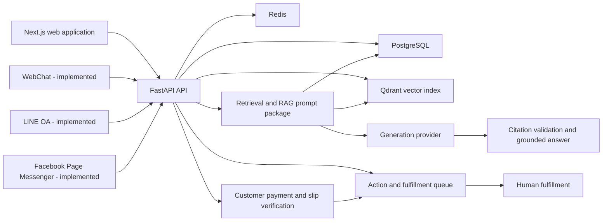
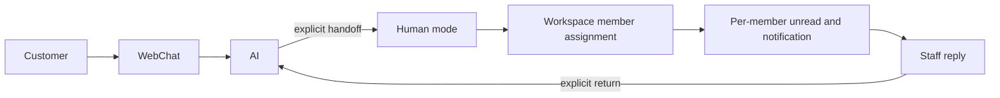

# OneInFlow

**Everything in one flow.**

OneInFlow is an **AI-first Customer Operations Platform** for managing customer conversations and the operational work that follows them through AI and human collaboration. Its core flow is Conversation -> Understanding -> Knowledge -> Action -> Human -> Payment -> Operations: **Everything in one flow.** The current product is an MVP and is not yet production-ready or a replacement for every CRM.

## Current architecture

The backend uses Python 3.12, FastAPI, Pydantic, async SQLAlchemy, Alembic, PostgreSQL, Redis, and Qdrant. Dependencies and commands are managed with `uv`. The frontend uses Next.js 15, React 19, TypeScript, Tailwind CSS, TanStack Query, Axios, `next-intl`, React Hook Form, and Zod.



PostgreSQL is the source of truth for tenant-owned document and chunk data. Qdrant stores searchable vector records, while retrieval validates results against trusted PostgreSQL rows before returning them.

## Knowledge and RAG pipeline

The implemented pipeline is:

1. Upload a workspace-owned document.
2. Extract supported text content.
3. Create deterministic, bounded chunks and SHA-256 hashes.
4. Generate embeddings through a provider-neutral interface and index vectors.
5. Retrieve workspace-filtered candidates and validate them against PostgreSQL.
6. Assemble a bounded, deterministic context with stable source labels.
7. Build a provider-neutral prompt package that treats queries and sources as untrusted data.
8. Generate a bounded response through the configured provider.
9. Validate every citation against trusted RAG sources before returning a grounded answer.

The RAG preview API exposes the prepared context and user prompt for development and inspection. The answer API adds provider-neutral OpenAI or deterministic development generation, skips generation when no knowledge is available, and rejects missing or invented citations. Neither endpoint exposes the system prompt, vectors, storage paths, provider responses, or secrets.

## Multi-tenant security

- Workspace identity comes from authenticated server-side context, never a client-supplied workspace ID.
- Document, chunk, indexing, retrieval, and RAG operations are workspace-scoped.
- PostgreSQL ownership checks protect against stale, forged, or cross-workspace vector hits.
- Prompt construction labels retrieved content as untrusted reference data and prevents it from creating structural delimiters.
- Public API responses and operational logs avoid secrets, vectors, storage paths, document content, and internal exception details unless content is explicitly part of an authenticated knowledge response.

## Authentication

The backend includes registration, email OTP verification, login, token-based protected routes, and password-reset flows. Verification codes are delivered through an email-provider abstraction and are not returned as authentication credentials. Workspace and user dependencies enforce access at the API boundary.

## Conversation platform

The public WebChat creates a scoped visitor session, persists customer messages, and routes each turn according to conversation mode. In `AUTO` and `COPILOT`, an active action collection has priority, an explicit supported action intent starts structured collection, and other input uses grounded generation. `HUMAN` mode never invokes AI or action collection.

Every WebChat send requires a caller-generated `client_message_id`. PostgreSQL uniquely scopes that ID to its conversation; sequential and concurrent retries return the original persisted customer/assistant result without repeating generation, collection, action creation, or payment-related work. Assistant metadata contains only the safe response data needed for citations and action-card recovery. It never stores system prompts, full RAG context, vectors, secrets, or confirmation-token hashes.

## Human handoff and in-app notifications

LINE OA and Facebook Page Messenger enter the same channel-neutral ingestion and
conversation orchestration used by WebChat. Provider adapters authenticate
webhooks, normalize text events, isolate identities by workspace connection,
reuse Message idempotency, and dispatch assistant/staff replies. Instagram,
Facebook Comments, Lead Ads, broadcasts, media, and rich templates are excluded.

Long-lived channel credentials are encrypted at rest with AES-256-GCM using the
server-only `CHANNEL_CREDENTIAL_ENCRYPTION_KEY`, random nonces, and
workspace/connection/provider AAD. External delivery is `PENDING`, `SENT`, or
`FAILED`; `SENT` means provider acceptance, not customer delivery/read. Failed
sends are not retried indefinitely or on every webhook retry.

An explicit customer request can move a WebChat conversation from AI handling to `HUMAN` mode without fuzzy intent matching. Staff can also request handoff, assign themselves or another verified workspace member, and explicitly return the conversation to `AUTO`. Returning to AI clears the active handoff/attention state while retaining assignment as operational history.

Unread state is truthful per workspace member: `ConversationReadState` stores each member's read cursor and unread counts are derived from customer messages after that cursor. AI messages and a staff member's own replies do not create unread customer work. In-app `Notification` records are recipient-scoped, workspace-isolated, deduplicated, and contain concise operational text only. Implemented sources include conversation handoff/assignment, new customer messages, action creation/assignment, and verified customer payments. No email, SMS, mobile push, browser push, or background delivery worker is included.



## Action and fulfillment queue

The authenticated Action API supports reusable workspace-owned action definitions, strict structured payload validation, idempotent action creation, staff assignment, controlled status transitions, queue filtering, and atomic audit events. The implemented flow is structured business data → confirmed ActionRequest → fulfillment queue → human fulfillment.

The Action queue remains manual-first and `AUTOMATED` is metadata only. AI-assisted collection is isolated from grounded answering and may create a queue item only through explicit validated confirmation. External API execution remains future work.

## Customer payment and slip verification

Customer Payment is money paid by an end customer to a Workspace business. It
is not OneInFlow SaaS billing.

## SaaS billing and entitlements

Sprint 9.2 adds data-driven plans, one effective Workspace subscription,
explicit boolean/limited/unlimited entitlements, billing-period usage, and
central server-side enforcement. Derived counts remain sourced from members,
Action Types, and Knowledge documents; AI usage records only real requests and
provider-reported tokens. Pricing v0.1 is provisional reference data. Production
checkout, plan mutation, automatic overage charging, and a verified billing
provider are not implemented. See [SaaS Billing](docs/12_SAAS_BILLING.md).

Customer Payment records money a customer pays directly to a workspace business; it is separate from OneInFlow SaaS Billing. The production flow uses EasySlip API v2 behind the provider-neutral `SlipVerificationProvider`, followed by deterministic `PaymentVerificationService` validation. The linked Action remains available for human fulfillment.

Evidence is limited to signature-validated JPEG/PNG files in opaque storage. Amount, currency, receiver, evidence hash, and transaction reference are checked by OneInFlow; EasySlip cannot directly mark a Payment verified. Raw provider responses and full account data are not persisted.

Slip Verification availability and quota come only from configured `PlanEntitlement` data. Usage is reserved safely before a production provider attempt; unavailable or exhausted entitlements are denied first. Provider pricing is external and is not hard-coded. See [Production Slip Verification](docs/13_SLIP_VERIFICATION.md).

## AI-assisted action collection and confirmation

Action collection follows a guarded flow: customer intent → a trusted workspace `ActionDefinition` → provider-assisted structured field proposals → deterministic `ActionPayloadValidator` validation → explicit missing/invalid-field collection → a deterministic confirmation summary → explicit confirmation → `ActionRequestService`. Collection state survives multiple turns without storing raw model prompts or responses, and confirmation tokens are random, stored only as payload-bound hashes, short-lived, and idempotent on retry.

Provider/LLM output is always untrusted and cannot directly create an ActionRequest, Payment, or PaymentVerification or perform a status transition. Action creation occurs only after the exact collected payload passes deterministic validation and an authenticated caller supplies its current confirmation token. Payment verification remains exclusively controlled by `PaymentVerificationService`. End-to-end WebChat orchestration is implemented, while external API execution remains future work.

## Project structure

```text
backend/
  alembic/                 Database migrations
  app/
    ai/                    Provider-neutral AI foundations
    auth/                  Authentication flows and dependencies
    integrations/          Email, embedding, and Qdrant adapters
    knowledge/             Knowledge HTTP routes
    models/                SQLAlchemy domain models
    rag/                   Context assembly and prompt building
    repositories/          Persistence boundaries
    services/              Application workflows
  tests/                   Unit and PostgreSQL-backed integration tests
frontend/
  app/                     Next.js App Router pages
  components/              Product and shared UI components
  hooks/                   Client data and interaction hooks
  messages/                Localized copy
```

## Local development

### Public Demo Chat

The landing-page AI demo is separate from tenant WebChat. It keeps history only
in browser state and does not create tenant or operational database records.
Answers use only the explicitly allowlisted public README/docs corpus and must
contain valid source citations.

`POST /api/v1/demo/chat` is protected before retrieval/generation by an atomic
Redis fixed-window limit. Identity is a hash of the direct connection IP;
forwarded headers are not trusted without an explicit trusted-proxy policy.
Limit breaches return 429 with `Retry-After`. Redis failure returns 503 and no
LLM call occurs. These limits protect public infrastructure and are not billing
quotas or subscription entitlements.

Configuration: `DEMO_CHAT_RATE_LIMIT_REQUESTS` (default `5`),
`DEMO_CHAT_RATE_LIMIT_WINDOW_SECONDS` (default `60`), and
`DEMO_CHAT_MAX_INPUT_CHARS` (default `1000`).

Prerequisites: Python 3.12, `uv`, Node.js with npm, Docker, and Docker Compose.

```powershell
git clone <repository-url>
cd oneflowai-platform

cd backend
Copy-Item .env.example .env
uv sync
docker compose up -d postgres redis qdrant
uv run alembic upgrade head
uv run uvicorn app.main:app --reload
```

On macOS or Linux, replace `Copy-Item .env.example .env` with `cp .env.example .env`. In another terminal:

```powershell
cd oneflowai-platform/frontend
npm install
npm run dev
```

The frontend defaults to `http://localhost:3000`; the API defaults to `http://localhost:8000`. Interactive OpenAPI documentation is available at `http://localhost:8000/docs` while the backend is running.

## Environment configuration

Copy `backend/.env.example` and configure values for the local environment. Important groups are:

- Application and security: environment, API prefix, signing secrets, allowed origins, and base-domain behavior.
- PostgreSQL and Redis: connection URLs used by the API and tests.
- Email: provider credentials and verification settings.
- Object storage: the configured document storage backend and limits.
- Embeddings and vector search: embedding provider/model, batch and dimension settings, Qdrant URL, collection, and retrieval limits.
- Chunking and RAG: chunk size/overlap, maximum chunks, maximum RAG sources, and context character budget.

Never commit real secrets. Use development providers only for local deterministic testing; production provider selection requires the corresponding credentials.

## Database migrations

Create schema changes through Alembic and keep exactly one current head:

```powershell
cd backend
uv run alembic current
uv run alembic heads
uv run alembic upgrade head
uv run alembic check
```

Generate a migration only when the persistent schema changes:

```powershell
uv run alembic revision --autogenerate -m "describe change"
```

Review generated migrations before applying them. The RAG context and prompt package are application-layer features and require no migration.

## Testing and quality checks

Backend lifecycle and transaction tests use PostgreSQL through `TEST_DATABASE_URL`; external providers are replaced with deterministic fakes.

```powershell
cd backend
$env:TEST_DATABASE_URL = "postgresql+asyncpg://<test-user>:<test-password>@localhost:5432/oneflowai_test"
uv run pytest -q
uv run ruff check .
```

Frontend checks:

```powershell
cd frontend
npm run lint
npm run build
```

## API overview

All application routes use the configured API prefix (normally `/api/v1`). Registered route groups cover authentication, workspaces, customers, conversations/messages, WebChat, Knowledge/RAG, Actions, Action Collection, Customer Payment, and notifications. Human operations include handoff, assignment/unassignment, return to AI, per-member read state, and recipient-scoped notification reads. See [API guideline](docs/04_API_GUIDELINE.md) for the implemented route inventory.

## Development status

Implemented:

- Multi-tenant users, workspaces, customers, and conversation foundations.
- Email-verification and password-reset authentication flows.
- Knowledge upload, extraction, deterministic chunking, hashing, and transaction-safe rechunking.
- Provider-neutral embeddings, Qdrant indexing, workspace-safe semantic retrieval, bounded context assembly, and deterministic prompt packaging.
- Provider-neutral grounded generation, zero-knowledge short-circuiting, normalized token usage, and strict citation validation.
- Generic manual Action/Fulfillment Queue with definitions, validation, assignment, lifecycle control, idempotency, and audit history.
- Customer-to-workspace Payment records, protected destinations, hardened slip evidence, duplicate controls, and provider-neutral verification.
- Persisted multi-turn AI-assisted Action Collection with strict field validation, payload-bound confirmation, and atomic ActionRequest creation.
- End-to-end WebChat routing for grounded answers, citations, action collection, explicit confirmation/cancellation, human mode, and concurrency-safe message idempotency.
- Human handoff, workspace-safe conversation assignment, per-member read state, and deduplicated in-app operational notifications.
- Shared text-first Channel Integration Layer for WebChat, LINE OA, and Facebook Page Messenger with authenticated webhooks, encrypted credentials, tenant-safe identity mapping, and truthful outbound delivery state.
- MVP operational dashboard with a live Overview composed from existing APIs, unified Inbox filters and delivery state, Action and Payment work queues, Knowledge pipeline/index controls, Channels, Notifications, and role-aware Workspace views in English and Thai.
- Workspace Action Type management for owner/admin users, including ordered required/optional fields, supported scalar/enum types, immutable keys, and enable/disable lifecycle; members retain read-only visibility.

In development:

- Further product UI refinement and broader conversation workflows.
- Operational hardening and expanded knowledge ingestion formats.

Planned:

- Sprint 9.4: Analytics and Insights.
- Sprint 9.4 operational Analytics is implemented from Workspace-scoped source
  tables with UTC ranges, truthful KPI definitions, and management-only access.
  See [Analytics and Insights](docs/14_ANALYTICS.md).
- Sprint 9.5: MVP Hardening and Pilot readiness — COMPLETE.
- Production configuration now fails closed on unsafe secrets, origins and
  development providers. Public Demo, WebChat and authentication use shared
  Redis-backed limits. See [MVP Hardening](docs/15_MVP_HARDENING.md),
  [Pilot Runbook](docs/16_PILOT_RUNBOOK.md),
  [Backup/Recovery](docs/17_BACKUP_RECOVERY.md) and the
  [Release Checklist](docs/18_RELEASE_CHECKLIST.md).

**OneInFlow status: MVP Complete — Pilot Ready.** This is not a claim of
Commercial Production Readiness; the documented MVP limitations and Pilot
operating controls still apply.
- Automatic external action execution.
- External notification delivery, asynchronous processing, expanded observability, and production deployment guidance.

## Design principles

- Tenant boundaries are enforced at every persistence and integration boundary.
- PostgreSQL remains authoritative; external indexes are treated as derived data.
- Determinism and idempotency make processing retryable and testable.
- Provider-neutral contracts keep external services replaceable.
- Security-sensitive inputs are untrusted by default and public failures remain sanitized.
- Changes stay within sprint scope and are backed by direct tests.

## MVP scope

The MVP provides WebChat, LINE OA and Facebook text messaging, grounded AI,
Actions, Customer Payment with EasySlip v2 verification, SaaS entitlements,
human collaboration and operational Analytics. It does not provide Instagram,
LINE/Facebook media ingestion, production subscription checkout, or a
commercial-production hosted-service guarantee.

## Documentation

- [Project vision](docs/00_PROJECT_VISION.md)
- [Product specification](docs/01_PRODUCT_SPEC.md)
- [Technical architecture](docs/02_TECH_ARCHITECTURE.md)
- [Database](docs/03_DATABASE.md)
- [API guideline](docs/04_API_GUIDELINE.md)
- [Roadmap](docs/06_ROADMAP.md)
- [Sprint board](docs/07_SPRINT_BOARD.md)
- [Deployment](docs/09_DEPLOYMENT.md)
- [Channel integrations](docs/10_CHANNEL_INTEGRATIONS.md)
- [MVP operations guide](docs/11_MVP_OPERATIONS.md)
- [Changelog](docs/CHANGELOG.md)

## Naming compatibility

The product name is **OneInFlow**. The historical repository directory identifier `oneflowai-platform` may remain in local paths and clone instructions for compatibility; it is not the current product brand.

## License

License information has not yet been published.
