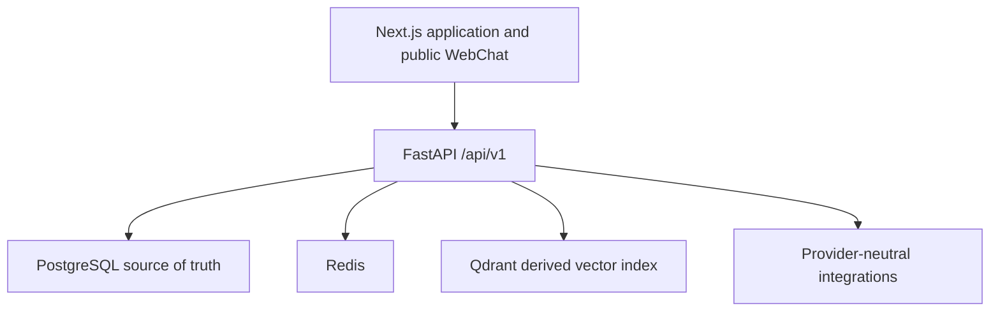
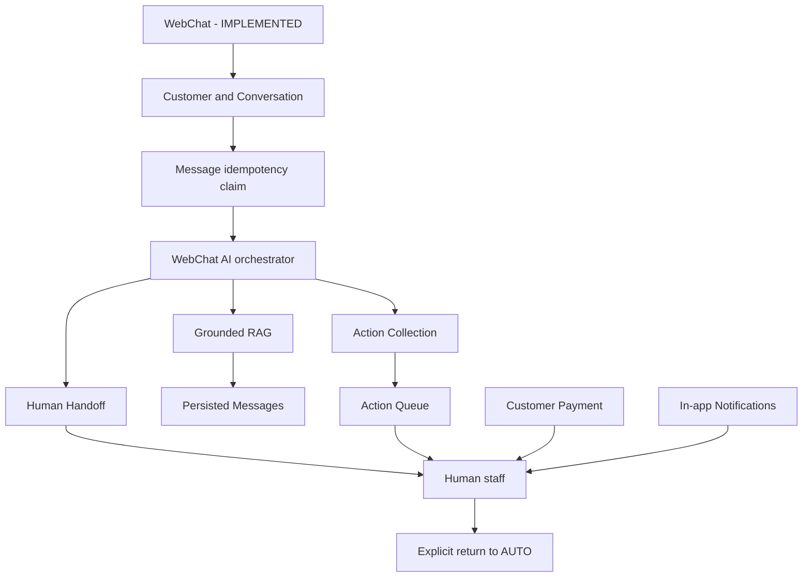
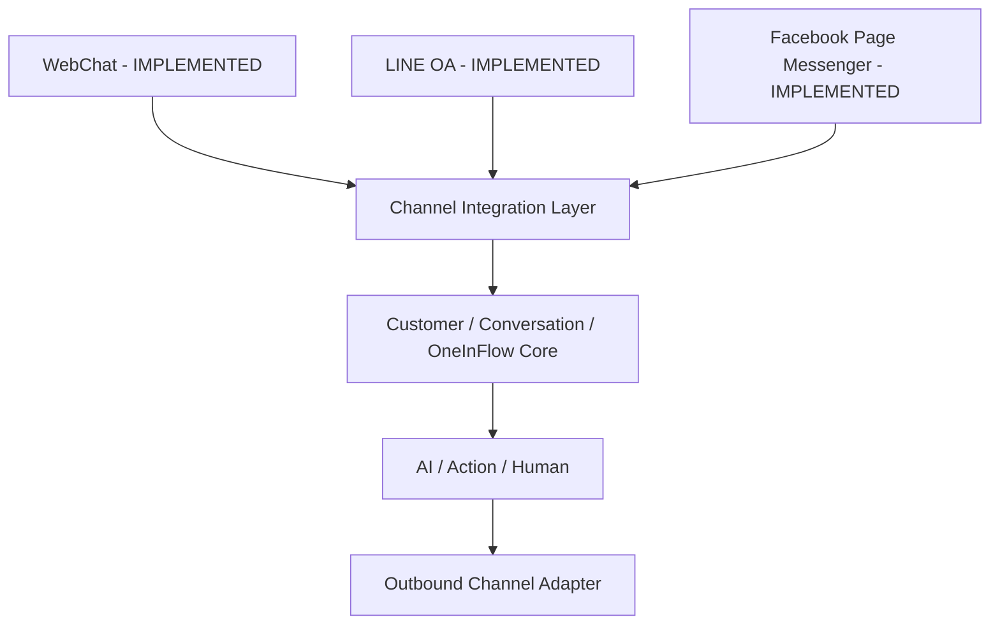

# Technical architecture

## Runtime



PostgreSQL is authoritative for tenant and operational state. Qdrant contains
derived searchable vectors; retrieval revalidates results against trusted
PostgreSQL rows.

## Implemented WebChat orchestration



PostgreSQL uniquely scopes `external_message_id` by conversation. A
savepoint-protected insert claims a WebChat request before AI/Action execution;
a concurrent loser recovers the persisted result rather than processing again.

## Human handoff and read state

```text
Customer request -> HUMAN -> needs_attention -> staff notification
                 -> workspace-member assignment -> staff interaction
                 -> explicit return to AUTO
```

Conversation state and notifications created by that operation share the same
PostgreSQL transaction. `needs_attention` is conversation-level operational
state. Unread is independently derived for each member from
`ConversationReadState`; it is not stored as a global conversation flag.

Notification creation deduplicates on workspace, recipient, and a deterministic
key. Notifications are synchronous database records, not external delivery or a
distributed delivery guarantee.

Recipient policy follows the active service paths: handoff and new-customer
message notifications go to the assigned member when present, otherwise to
workspace owners/admins; conversation assignment and Action assignment notify
the assignee; Action creation notifies owners/admins; verified Customer Payment
notifies the member assigned to its linked Action when present, otherwise
owners/admins.

## Provider boundaries

Implemented provider contracts include:

- `EmbeddingProvider`
- `GenerationProvider`
- `ActionFieldExtractionProvider`
- `ActionIntentProvider`
- `SlipVerificationProvider`

Provider/model output is untrusted. Knowledge cannot override system authority;
Action creation requires deterministic validation and explicit confirmation;
AI cannot mark a Customer Payment `VERIFIED`.

## Security boundaries

- Authenticated workspace context scopes staff operations; assignment targets
  are validated against `WorkspaceMember` in the same workspace.
- The public WebChat session supplies trusted workspace/conversation identity
  and cannot assign staff, mark staff read state, or read/mutate notifications.
- Notification list/read operations require both workspace and recipient match;
  read cursors are isolated per member.
- Client-provided workspace/user IDs do not override authenticated authority in
  the implemented routes.
- Knowledge is untrusted reference data and cannot override system authority.
- Provider secrets stay server-side; public errors and notification bodies avoid
  sensitive operational payloads.

## Sprint 9.0 Channel Integration Layer - IMPLEMENTED

LINE and Facebook adapters authenticate and normalize provider traffic before
the shared ingestion service resolves connection, identity, customer,
conversation, Message idempotency, orchestration, and outbound state.



Credential bundles use AES-256-GCM with random nonces and AAD bound to trusted
workspace, connection, and provider IDs. Delivery rows ensure one external send
per outbound Message and preserve `PENDING`/`SENT`/`FAILED` truth. Provider
errors are normalized and raw bodies/responses are not persisted.

## Sprint 9.1 operational frontend - IMPLEMENTED

The Next.js dashboard composes existing conversation, action, knowledge,
payment, channel, notification, and workspace contracts through React Query.
There is intentionally no `/dashboard/overview` API, database migration, or
frontend copy of backend transition/authorization rules. Polling remains the
current near-real-time mechanism; WebSockets and background analytics are not
part of Sprint 9.1.

Action Type management reuses the existing `ActionDefinition` model and JSONB
field arrays. `POST` and `PATCH` definition routes require an authenticated
workspace owner/admin; member `GET` access remains available. Repository
queries retain workspace predicates. No schema change or migration is needed.

## Public Demo Chat boundary

The landing-page Demo Chat is a stateless public product surface, not tenant
WebChat or a production customer channel. Browser refresh clears its React-state
history. Its API has no database dependency and retrieves only from the approved
public documentation allowlist; answers require valid citations.

Before retrieval or generation, a Redis Lua script atomically increments a
fixed-window counter and applies expiry. Keys contain a SHA-256-derived client
identity rather than the raw direct socket IP. `X-Forwarded-For` is deliberately
ignored until deployment defines trusted proxies. Exceeded limits return 429
with `Retry-After`; Redis failure returns 503 and prevents any LLM call. This
ephemeral state is abuse protection, not tenant usage or entitlement data.
