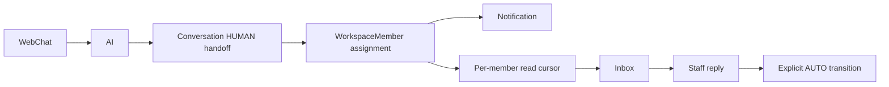

Next.js

↓

FastAPI

↓

Redis

↓

PostgreSQL

↓

Qdrant

↓

Provider-neutral generation and action-intent adapters

↓

LINE OA

WebChat request flow

WebChat session token -> conversation mode guard -> active Action Collection ->
explicit action intent -> grounded RAG answer -> persisted Messages.

PostgreSQL owns message idempotency through a unique
`(conversation_id, external_message_id)` key. A savepoint-protected insert
claims a WebChat request before AI or action execution. A losing concurrent
request recovers the stored result instead of processing it again.

Trust boundaries

- Workspace and conversation identity come from the authorized WebChat session.
- AI output cannot create an ActionRequest without deterministic validation and explicit confirmation.
- Payment verification is separate and is never controlled by WebChat generation.
- Qdrant is derived search data; PostgreSQL remains authoritative.

Human operations flow

Conversation state and its notifications are written in the same PostgreSQL
transaction. Notification uniqueness is scoped by workspace, recipient, and a
deterministic deduplication key. This is local database atomicity, not a claim of
distributed delivery guarantees.
